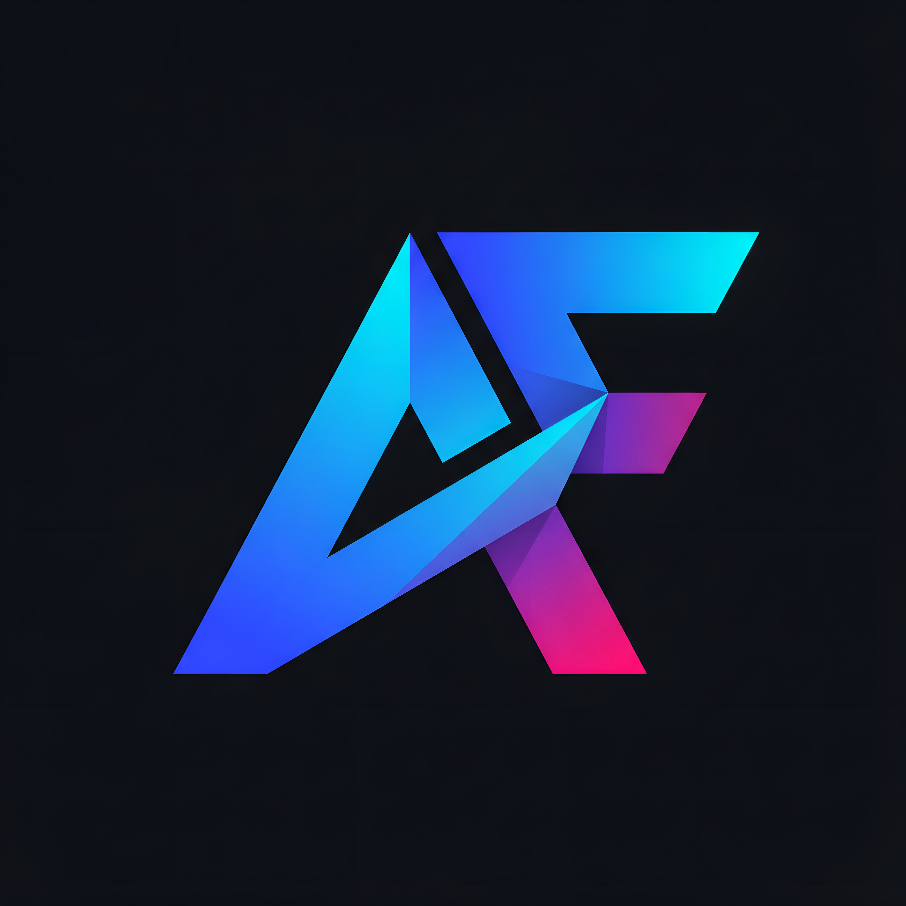
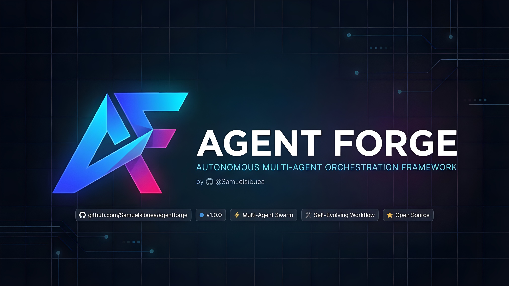
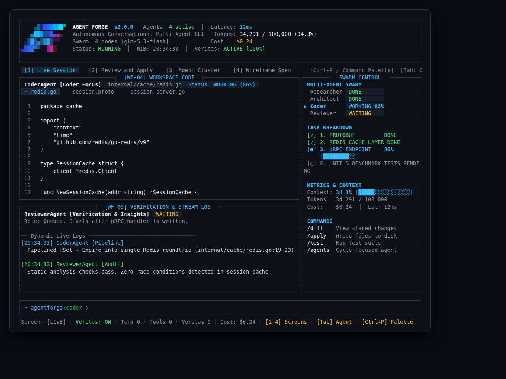

<p align="center">
  
</p>

<h1 align="center">AgentForge</h1>

<p align="center">
  
</p>


[](https://github.com/Samuelsibuea/agentforge/actions/workflows/ci.yml)
[](#benchmark)
[](agent/mcp.py)


> End-to-end AI agent ecosystem on the Inference API: a self-written harness
> (agent loop + SSE parser + tool router), modular skills, a scoped workspace,
> and a research workflow that turns a topic into a real markdown report —
> with live internet data, tool-call audit log, and provenance.

```
                    ┌───────────────────────────────────┐
   topic / task ───►│  agent/core.py  — the harness     │
                    │  ├─ SSE streaming parser          │
                    │  ├─ tool-call decode + dispatch   │
                    │  ├─ memory + loop control         │
                    │  ├─ quota + hard-stop recovery    │
                    │  └─ artefact enforcement          │
                    └────────────────┬──────────────────┘
                                     │ tool_calls (JSON over SSE)
                    ┌────────────────▼──────────────────┐
                    │  tools/router.py — registry       │
                    │  schema · quota · runs.jsonl log  │
                    ├───────────┬──────────┬────────────┤
                    ▼           ▼          ▼            ▼
              web_search    web_fetch  file_read/     calc
              HN Algolia    HTTP live  write/list     decimal
              +GitHub+Wiki             workspace-     (high
                                       scoped         precision)
                                     │
                    ┌────────────────▼──────────────────┐
                    │  workspace/output/<slug>.md       │
                    │  final report + sources + trace   │
                    └───────────────────────────────────┘
```

## Live demo

Real run, 19 Nov 2026 09:49 WIB — one command, topic in, report out:

```console
$ python workflow.py "Apa itu RAG? Jelaskan dalam 3 paragraf"

[workflow] topik: Apa itu RAG? Jelaskan dalam 3 paragraf
  [tool] web_search({"count": 6, "query": "Retrieval-Augmented Generation RAG definition how it works"})
  [tool] web_search({"count": 6, "query": "RAG retrieval augmented generation kelebihan kekurangan LLM"})
  [tool] web_fetch({"max_chars": 6000, "url": "https://en.wikipedia.org/wiki/Retrieval-augmented_generation"})
[workflow] trace:
   {"turn": 0, "type": "tool", "name": "web_search",  "ok": true}
   {"turn": 0, "type": "tool", "name": "web_search",  "ok": true}
   {"turn": 1, "type": "tool", "name": "web_fetch",   "ok": true}
   {"turn": 2, "type": "final", "len": 3524, "artefak": "workspace/output/apa-itu-rag-jelaskan-dalam-3-paragraf.md"}
[workflow] answer:
# RAG (Retrieval-Augmented Generation)
...
[workflow] workspace/output:
   workspace/output/apa-itu-rag-jelaskan-dalam-3-paragraf.md  3589 bytes
```

Artefak sha256 `ec10b86d…c1b990f0`, 19 lines, sitasi sumber live
(en.wikipedia.org/wiki/Retrieval-augmented_generation).
Every tool call lands in `workspace/log/runs.jsonl` — WIB timestamp, tool,
args, ok/error, duration. Full provenance, replayable.

## Layout

```
agentforge/
├── agent/
│   ├── core.py          # Agent loop: SSE parser, tool-call decode, memory, enforcement
│   ├── cli.py           # Interactive CLI + single-shot mode
│   ├── commands.py      # Slash-command registry (/doctor /status /skills ...)
│   ├── cron.py          # Cron scheduler: 5-field jadwal, standar
│   ├── hooks.py         # Event hooks: session_start/pre_tool/post_tool/session_end
│   ├── keyring.py       # BYOK credential pool: add/ls/rm/rotate, chmod 600, zero plaintext
│   ├── learn.py         # self-improving: successful run → skill auto-template |
│   ├── rules.py         # stream rules: regex on content → inject reminder |
│   ├── serve.py         # HTTP + SSE serve mode (standar) |
│   ├── store.py         # session store: export/import JSON |
│   ├── tui.py           # prompt_toolkit TUI: gradient header, live sidebar, WIB footer |
│   └── veritas.py       # verification layer: re-run tool calls, byte-match, AST-safe calc |
├── assets/
│   ├── logo-mark.png        # brand mark (4096×4096, dark ground #0d1117) |
│   ├── logo-lockup.png      # vertical lockup: mark + wordmark |
│   ├── logo-horizontal.jpg  # horizontal lockup: mark + wordmark + tagline |
│   └── DESIGN.md            # design tokens + reference library (shadcn/dribbble/terminal) |
├── tools/
│   ├── router.py        # Tool registry, dispatcher, JSON schema, run log
│   ├── web.py           # web_search (HN Algolia + GitHub + Wikipedia, dedup), web_fetch
│   ├── files.py         # file_read / file_write / file_list (workspace-scoped)
│   └── calc.py          # High-precision calculator (decimal)
├── skills/
│   ├── research.md      # Research skill: search → fetch → synthesize → report
│   ├── coding.md        # Coding skill: draft → verify → polish
│   └── summarize.md     # Summarization skill: fetch → extract → bullet
├── workflow.py          # End-to-end workflow: research topic → report .md
├── test_consistency.py  # Harness consistency suite (loop · quota · SSE parse · artefact)
├── config.example.json  # Config template (config.json is git-ignored, add your api_key)
└── README.md
```

## Tools (6, all live)

| Tool | Mechanism | Quota/task |
|---|---|---|
| `web_search` | Live HTTP: HN Algolia + GitHub API + Wikipedia API, dedup | 3 |
| `web_fetch` | HTTP GET + text extraction (title + paragraphs) | 3 |
| `file_read` | Read files inside workspace | — |
| `file_write` | Write files inside workspace | 2 |
| `file_list` | List workspace directory | — |
| `calc` | High-precision calculator (decimal) | — |

Every tool call is logged to `workspace/log/runs.jsonl` — each entry carries a
WIB timestamp, tool, args, ok/error, and duration.

## Quick start

```bash
pip install httpx            # single dependency
cp config.example.json config.json
# add your api_key (event key via @KeiInferenceBot)

# single-shot research
python workflow.py "Compare Python agent frameworks: LangGraph vs CrewAI vs AutoGen"

# interactive shell
python -m agent.cli
```

Interactive shell (`/help` untuk daftar lengkap):

| Perintah | Fungsi |
|---|---|
| `/doctor` | cek config, endpoint live, skills, tools, runs log |
| `/status` | model, endpoint, memory, artefak |
| `/skills` · `/skill <nama>` | daftar + ganti skill aktif |
| `/history` | 8 run terakhir dari `runs.jsonl` |
| `/clear` | bersihkan memory sesi |
| `/exit` | keluar |

Prompt: `➜ agentforge:<skill> ❯` dengan history (FileHistory), slash-command
autocomplete, statusline bawah, progress tool-call ke stderr, dan Ctrl+C
yang membatalkan tool call tanpa mematikan sesi.

### TUI (optional)

```bash
pip install prompt_toolkit
python -m agent.tui
```

prompt_toolkit TUI — header gradient, sidebar status live (model · skill ·
key · memory · turn), chat panel newest-first, footer WIB live clock.
Truecolor dipaksa 24-bit (`PROMPT_TOOLKIT_COLOR_DEPTH=DEPTH_24_BIT`) supaya
GitHub-dark palette presisi, bukan 8-bit. Interaksi headless via tmux:
`tmux send-keys -t tui "<task>" Enter` + `tmux capture-pane -p` untuk bukti.

## Configuration

`config.json`:
```json
{
  "api_key": "sk-...",
  "base_url": "https://ai.kei-inference.web.id/v1",
  "model": "glm-5.3-flash",
  "max_turns": 15,
  "workspace": "workspace"
}
```

## Workflow (end-to-end)

1. Agent receives the topic from CLI/argument.
2. The `research` skill activates → agent calls `web_search` (live HTTP).
3. For each relevant result: `web_fetch` → extract text.
4. Agent synthesizes → markdown report becomes the **final answer**.
5. The harness enforces the artefact: if the agent did not `file_write`, the
   harness auto-saves the answer to `workspace/output/<slug>.md`.
6. Prints summary + file path + provenance (tool-call log + HTTP status).

## Harness resilience

- The Inference API server always responds with SSE → the client parses SSE chunks
  (`data:` lines), accumulating `delta.content` + `delta.tool_calls[index]`
  (OpenAI-compatible format).
- 4× retry on 5xx/429/timeout; tool quota (3 search / 3 fetch / 2 write).
- Long JSON arguments can be truncated server-side → harness fallback parse +
  **hard-stop**: 2 consecutive tool failures → final recovery without tools.

## UI / TUI & Wireframe

TUI berbasis `prompt_toolkit` dengan fidelitas 1:1 terhadap wireframe spec `WF-01` s/d `WF-12`:



- **Official Brand Mark**: Render logo glyph resolusi tinggi via RGB half-block matrix 24-bit truecolor (`#02eeff` cyan ke `#2435ae` navy) di header telemetry.
- **Model Context Protocol (MCP)**: Dukungan penuh stdio client JSON-RPC 2.0 (`agent/mcp.py`) untuk menghubungkan MCP servers eksternal (auto-discovery skema tool & auto-register ke router).
- **4 Layar Interaktif**:
  - `[1] Live Session`: Code Card (`internal/cache/redis.go`, sub-tabbing), Reviewer card & Dynamic live stream logs.
  - `[2] Review and Apply`: Staged workspace diff viewer (`/diff`), toggle checkbox staging, write to disk (`/apply`).
  - `[3] Agent Cluster`: Swarm management (Researcher, Architect, Coder, Reviewer), pause/resume per-node, inspect system prompt.
  - `[4] Wireframe Spec`: Architectural map WF-01..12 inspector langsung di dalam CLI.
- **Shortcut & Controls**:
  - `1`, `2`, `3`, `4`: Pindah antar layar.
  - `Tab`: Cycle focused agent highlight.
  - `Esc`: Pause / Resume swarm session.
  - `f`: Switch active file preview.
  - `Ctrl+P`: Command palette prompt.

Screenshots layar lainnya:
- [Review and Apply Screen](assets/cli-screenshot-review.png)
- [Agent Cluster Swarm Screen](assets/cli-screenshot-cluster.png)

Jalankan TUI:
```bash
python -m agent.tui
# atau jalankan automated test suite 12-check wireframe
python test_cli_wireframe.py
```

### Fitur inti — self-improving harness

| Fitur | Mekanisme |
| :--- | :--- |
| Fallback-chain model | `models.chain` — model gagal → next di chain |
| Token budget gate | `token_budget` — habis → final sekarang |
| Approval ladder | `approval_mode: ask/write/yolo` |
| Event hooks | `session_start/pre_tool/post_tool/session_end` |
| Stream rules | regex pada content → inject reminder |
| Hashline edit | `file_patch(path, old_hash, new_content)` — stale anchor reject |
| **Veritas layer** | gamechanger — harness bikin + jalan kan kode verifikasi tiap tool call |
| **Self-Evaluation Arena** | Skoring otomatis 0-100 `agent/eval_arena.py` across 4 pilar (Factuality, Constraints, Precision, Conciseness) via `/eval` |
| **Autonomous Self-Healing** | Parser traceback `agent/self_heal.py` — deteksi frame, baris, tipe error & auto-diagnose |
| **Session Replay HTML** | Export log percakapan & trace Veritas ke file HTML statis interaktif (`/replay`) |
| **Interactive Autocomplete** | `prompt_toolkit` WordCompleter live suggestions untuk seluruh slash commands |
| **Workspace Checkpoint & Undo** | Atomic snapshot `.checkpoints/` + 1-command rollback `/checkpoint rollback` |
| **Execution Modes Engine** | 6 mode: `auto`, `plan`, `fast`, `reasoning` (thinking), `vision`, `workflow` |
| **Model Context Protocol (MCP)** | JSON-RPC 2.0 stdio client — auto-discovery & register external tool servers |
| **Subagent Swarm (`delegate_task`)** | Delegasi paralel/sekuensial 4 role (researcher, architect, coder, reviewer) |
| **User Custom Tools (`/tool create`)** | Buat tool Python kustom secara instan dengan auto-generated schema & hot-reload |
| **User Custom Skills (`/skill create`)** | Buat persona & skill domain baru tanpa batas prompt langsung aktif |
| **Skill Marketplace (`/skill catalog`)** | Katalog preset skill siap install (devops, pentest, data-analyst) |
| **GitHub CI Workflow** | Automasi GitHub Actions `.github/workflows/ci.yml` + benchmark evaluator |
| **Context Compactor** | Auto-prune context window saat mendekati budget, pertahankan initial goal & tail |
| **Benchmark Suite (`benchmark.py`)** | Evaluasi 5 pilar arsitektur otomatis dengan laporan latency & presisi |
| Serve mode | `python -m agent.serve` → HTTP + SSE, POST /v1/chat |
| Session export/import | `/export` `/import` → JSON session |
| Stats | `/stats` — tool use, quota, veritas |
| Models list | `/models` — chain + provider + key aktif |
| BYOK | `/keys add/ls/rm/rotate` — chmod 600, nol plaintext |
| Key rotation | 429 → mark_fail → rotate ke key hidup |
| Cron | `/cron add/ls/rm/pause/resume/tick` — jadwal 5-field |
| Learn | `/learn <trigger>` — run berhasil → skill otomatis |

Veritas + BYOK + cron + learn live E2E terverifikasi di test_cron_learn.py (18/18). `agent/veritas.py` rehitung
calculate (AST-safe), baca ulang file_write (byte match), cek web_fetch panjang
konten — verdict tercatat di trace.
- **Artefact enforcement**: if the agent never calls `file_write`, the harness
  auto-saves the final answer.
- Bing/DDG/Google/Mojeek/SearxNG/Ecosia wall datacenter IPs → the search chain
  uses stable open API endpoints (HN Algolia, GitHub, Wikipedia), keyless.

## Brand

| Aset | File | Pakai |
| :--- | :--- | :--- |
| Mark | `assets/logo-mark.png` | favicon, avatar, header README |
| Lockup vertikal | `assets/logo-lockup.png` | splash, about |
| Horizontal | `assets/logo-horizontal.jpg` | hero README, situs, slide |
| Tokens | `assets/DESIGN.md` | palet GitHub-dark, radius, motion |

Logo + wordmark: aset resmi AgentForge (`assets/`). Palet identitas = palet TUI
(satu sistem, ground `#0d1117` → primary `#58a6ff` → success `#3fb950`).

## Design notes

- Tools are read/write-local only: search, fetch, files in your own workspace,
  calculator. No remote administration, no credential access, no exfiltration.
- All written data stays inside `workspace/` on your machine.
- One dependency: `httpx`. No external services beyond the Inference API
  and the open search endpoints listed above.

---

**AgentForge** — a self-written harness, seven live tools, real reports from
real data. Built on the Inference API.
